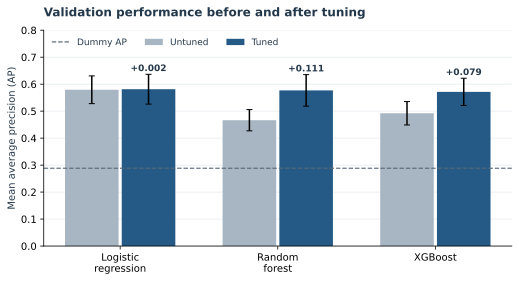
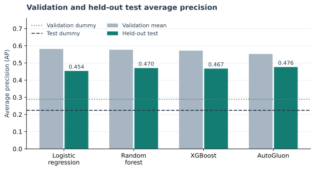
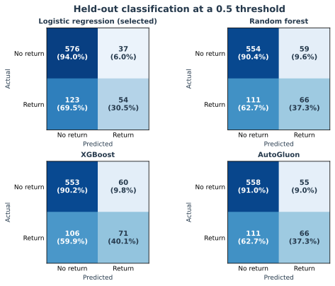

# Figures for the paper

These figures were generated from the archived E01–E04 aggregate CSVs using `gameplay_ml/plot_results.py`. No model was retrained and no individual user records were used. SVG files are included for publication-quality scaling; the script also produces 300 DPI PNGs for Word.

## Figure 1 — Validation performance before and after tuning



Suggested caption: Mean average precision from the same five chronological validation folds, before and after grid search. Error bars are one sample standard deviation across folds (not confidence intervals), and the dashed line marks the mean dummy AP of 0.2884. The labels show absolute AP improvement. Tuning improved Random Forest most (+0.1105), followed by XGBoost (+0.0794); Logistic Regression improved only +0.0021.

## Figure 2 — Validation versus held-out performance



Suggested caption: Mean validation AP versus final test AP for the best configuration of each manual classifier and the AutoGluon procedure. The two dummy lines reflect different return prevalences: 28.8% on average in validation versus 22.4% on the test cohort. AutoGluon used fewer effective fitting rows because of its inner time-aware validation gap. Logistic Regression was selected before the held-out evaluation, although AutoGluon had the highest observed test AP. The test scores are descriptive; they are not a basis for further model selection.

## Figure 3 — Confusion matrices



Suggested caption: Confusion matrices for the four final model procedures at the fixed 0.5 probability threshold on the same 790 held-out players (613 non-returners and 177 returners). Cells display actual counts and percentages within the actual-class row. For example, the validation-selected Logistic Regression correctly identified 54 of 177 returners, while XGBoost identified 71. The relatively high overall accuracy partly reflects the class imbalance.

## Reproduce

Use a separate plotting environment to avoid changing the pinned baseline or AutoML dependencies:

```powershell
py -3.11 -m venv .venv-plots
.\.venv-plots\Scripts\python.exe -m pip install -r requirements-plots.txt
.\.venv-plots\Scripts\python.exe -m gameplay_ml.plot_results
```

Outputs appear under `results/figures/`. Use a new `--output` folder to regenerate without overwriting previous results. The first run used Python 3.12.14, Matplotlib 3.10.8 and NumPy 2.3.5.
